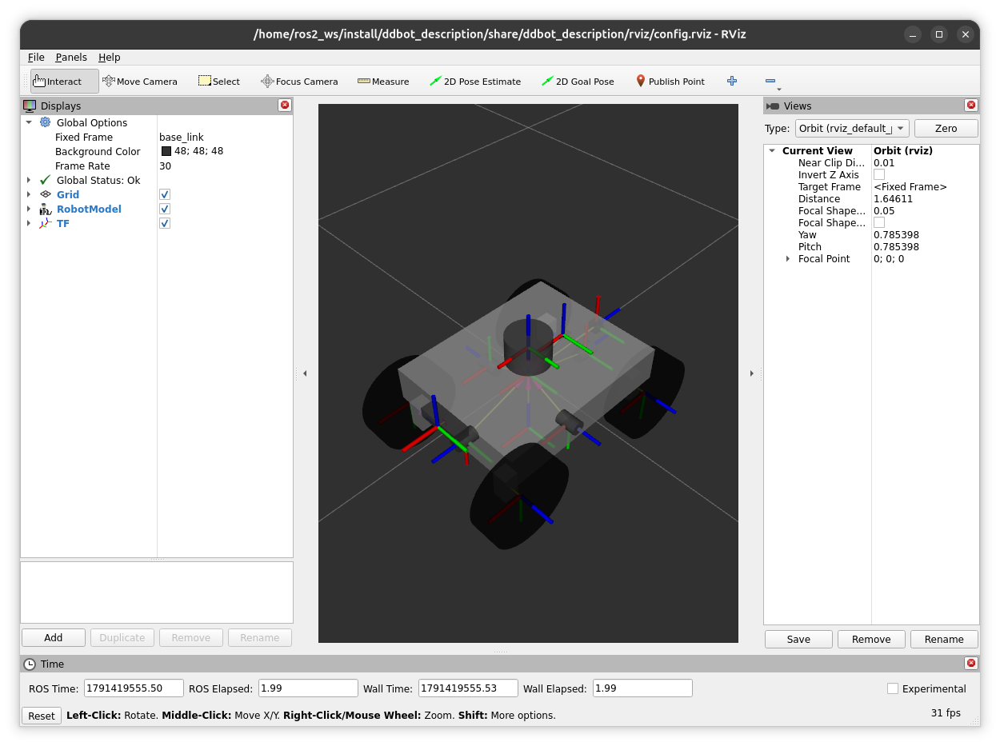

# README.md

## Цель
Проверить практические навыки моделирования, программирования и интеграции сенсоров для автономного мобильного робота в симуляторе Gazebo с использованием ROS.

## Задача
В симуляторе Gazebo создать сцену и запрограммировать автономный проезд робота из точки А в точку Б с объездом препятствий. Робот должен использовать данные сенсоров: лидар или ультразвуковые датчики, камеру глубины (эмуляция Orbbec Astra), GPS.

## Исходные данные
- Робот: любой (TurtleBot3, Jackal или собственный URDF/Xacro).
- Обязательные сенсоры: 2D лидар или ультразвуковые дальномеры; камера глубины (depth camera plugin как аналог Orbbec Astra); GPS (gazebo_ros_gps).
- Среда: ROS 1 Noetic или ROS 2 Humble (на выбор кандидата, зафиксировать в README). Симулятор Gazebo Classic или Ignition.
- Мир: плоская поверхность, несколько статических препятствий, обозначенные стартовая и финишная зоны.

## Требования к выполнению
1. Робот стартует из точки А и автономно доезжает до точки Б, не касаясь препятствий.
2. Маршрут задаётся waypoints в GPS-координатах или в системе координат мира.
3. Необходимо использовать ROS: узлы, топики, tf, launch-файлы.
4. Допускается использование готовых пакетов (nav2, gmapping, amcl, move_base), но кандидат должен понимать их настройку.
5. Код на Python или C++.
6. Записать демонстрационное видео (Gazebo + RViz) и, по возможности, rosbag.

## Этапы выполнения
1. [x] Выбрать или создать модель робота с сенсорами и плагинами.
2. [x] Создать мир в Gazebo с препятствиями и зонами старта/финиша.
3. [] Реализовать узлы ROS для:
    - [x] чтения данных сенсоров;
    - [x] построения карты или использования SLAM;
    - [] планирования пути и управления;
    - [] следования по GPS-точкам.
4. [] Запустить и отладить симуляцию.
5. [] Записать видео 1–3 минуты.
6. [] Оформить Git-репозиторий с README (инструкция запуска, зависимости, описание).

## Описание пакетов ROS 2

> Перед запуском необходимо забилдить пакеты:
```bash
colcon build --symlink-install
source install/setup.bash
```

## ddbot_description
Содержит описание 4-колесного мобильного робота с дифференциальным приводом:
```bash
ros2 launch ddbot_description rviz.launch.py
```



## ddbot_gazebo
Содержит описание контроллера дифференциального привода и датчиков (imu, gps, lidar, depth camera):
```bash
ros2 launch ddbot_gazebo full.launch.py
```

[Открыть видео](./assets/ddbot_gazebo.mp4)

> Карта с препятствиями построена благодаря [Dynamic World Generator Wizard](https://github.com/ali-pahlevani/Dynamic_World_Generator)